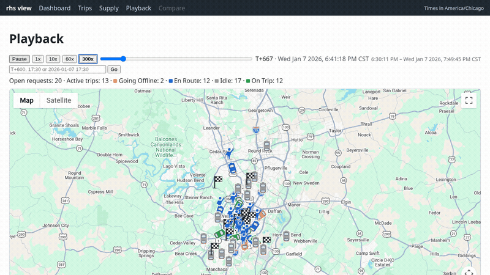

# ride-hailing-simulator

A deterministic, event-driven simulator for testing ride-hailing and robotaxi fleet strategies before they reach real riders. You give it ride requests, driver shifts and a settings file. It replays them second by second: your matcher assigns cars, the router drives them, and the simulator logs every pickup, dropoff, cancellation and GPS-like position. Identical inputs give byte-identical outputs, so you can run two strategies on the same supply and demand and know any difference comes from the strategy. A built-in viewer lets you replay and compare the runs on a map.



## Why use it

- **Pluggable strategies.** Matchers, routers and driver behaviors are Go interfaces that you register by name and choose in `settings.toml`. Readers and writers are interfaces too, with CSV and TOML built in. The core holds no strategy logic.
- **Straight-line or real roads.** The built-in haversine router needs no setup. The [OSRM](docs/osrm.md) router drives real road geometry, with a one-command Docker setup and an optional cache so reruns don't need the server.
- **Marketplace mechanics built in.** Pooling with seat limits, reassignment before pickup, batched matching on a fixed interval, pickup and dropoff dwell times, rider cancellation timeouts, driver repositioning, and generic mid-trip handoffs.
- **Deterministic and auditable.** Each run records SHA-256 hashes of its requests, supply and settings in `run_metadata.csv`, so paired runs are provably comparable.
- **Rich outputs.** Per-trip waits, detours and pickup distances; per-car state logs with driven and planned polylines; utilization and deadhead; and a run summary.
- **A viewer, `rhs view`.** It has a dashboard, trip and supply drill-downs, map playback, and A/B run comparison with paired per-trip deltas.
- **Reproducible benchmarks.** [`austin_weekday_10k`](benchmarks/austin_weekday_10k/README.md) and [`austin_weekday_100`](benchmarks/austin_weekday_100/README.md) are built from public RideAustin data by seeded, byte-reproducible scripts, with published reference runs.
- **Runs end when the work does.** By default a run stops once every request is resolved, so idle supply doesn't inflate the metrics.

## Quickstart

Requires Go 1.22+.

```sh
git clone https://github.com/realjonathanhester/ride-hailing-simulator && cd ride-hailing-simulator
go test ./...                                    # component tests
go run ./cmd/rhs run -settings benchmarks/austin_weekday_100/settings.toml \
  -supply benchmarks/austin_weekday_100/supply.csv \
  -requests benchmarks/austin_weekday_100/requests.csv -output out/austin_100
GOOGLE_MAPS_API_KEY=... go run ./cmd/rhs view -output out/austin_100
# open http://127.0.0.1:8080/playback
```

The run writes `trips.csv`, `supply_event_log.csv`, `supply_summary.csv`, `run_summary.csv` and `run_metadata.csv` to `out/austin_100`. Without a Maps key every viewer page still works, but maps are disabled. Add `-compare out/other_run` to compare two runs; see [docs/viewer.md](docs/viewer.md).

## Plug in your own matcher

A matcher implements one method from [`model`](model/model.go):

```go
type Matcher interface {
	Match(input MatchInput) []PlanChange
}
```

`MatchInput` holds the time, the trigger (`request`, `supply_online`, `supply_offline` or `batch_tick`), the settings, every online car with its location, state and current plan with ETAs, every open request, and the router. Return a `PlanChange{SupplyID, Plan}` for each car whose ordered stops should be replaced. The simulator validates the plans, routes them and executes them.

[`examples/nearestidle`](examples/nearestidle/main.go) is a complete program that gives each waiting request the closest idle car:

```go
type NearestIdle struct{}

func (NearestIdle) Match(in model.MatchInput) []model.PlanChange {
	taken := map[string]bool{}
	var changes []model.PlanChange
	for _, r := range in.Requests {
		if r.Status != model.StatusRequested {
			continue
		}
		best, bestMeters := "", int64(-1)
		for _, s := range in.Supplies {
			if taken[s.SupplyID] || len(s.Plan) > 0 || s.State == model.StateGoingOffline {
				continue
			}
			if d := routing.HaversineMeters(s.Location, r.Origin); bestMeters < 0 || d < bestMeters {
				best, bestMeters = s.SupplyID, d
			}
		}
		if best != "" {
			taken[best] = true
			changes = append(changes, model.PlanChange{SupplyID: best, Plan: []model.Stop{
				{RequestID: r.RequestID, Type: model.Pickup}, {RequestID: r.RequestID, Type: model.Dropoff}}})
		}
	}
	return changes
}

// in main: runner.RegisterMatcher("nearest_idle", func() (model.Matcher, error) { return NearestIdle{}, nil })
```

```sh
go run ./examples/nearestidle -settings examples/nearestidle/settings.toml \
  -supply benchmarks/austin_weekday_100/supply.csv \
  -requests benchmarks/austin_weekday_100/requests.csv -output out/nearestidle
```

Routers (`runner.RegisterRouter`) and driver behaviors (`runner.RegisterDriverBehavior`) plug in the same way.

## Documentation

- [Overview](docs/overview.md): why a simulator, how inputs and outputs fit together, and the repository layout
- [Specification](docs/spec.md): settings, hooks, event loop and output columns
- [Viewer](docs/viewer.md) and the [tooling specification](docs/tooling_spec.md)
- [Real roads with OSRM](docs/osrm.md)
- [Benchmarks](docs/benchmark_spec.md) and the [test specification](docs/test_specs.md)

## License

MIT
