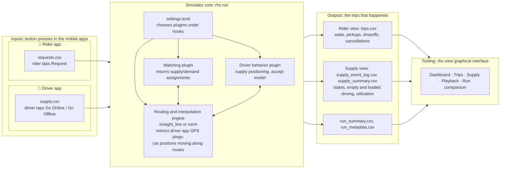

# Overview

Background and architecture, moved from the README. The formal behavior is in the [specification](spec.md).

## Why a simulator?

ride-hailing-simulator is a laboratory for fleet management strategies, such as matching, pooling, batching and reassignment, for ride-hailing and autonomous fleets.

### Production experiments are slow and noisy

Ride-hailing is a two-sided marketplace, and that breaks standard experimentation:

- **A/B tests are biased.** Riders in treatment and control compete for the same cars. A matcher that grabs nearby cars for its own riders looks great while quietly hurting the control group.
- **Splitting supply has its own problems.** Giving each arm its own fleet removes that competition, but each half-size fleet behaves differently from the full marketplace, since density drives ETAs and pooling. Riders also see fewer nearby cars, and you need enough supply to split in the first place.
- **Switchback experiments are underpowered.** Alternating the whole market between strategies over time avoids that interference. But each time block becomes a single data point, so detecting small effects can take weeks.
- **Experiments are costly.** Every bad variant costs real riders, real drivers and real money.

### A perfect world, on purpose

The simulator makes strong simplifying assumptions: cars drive exactly as the routing engine specifies, pickups are seamless, nobody takes a wrong turn, and every assignment is accepted. Those assumptions will never hold in reality, and that's the point. A deterministic runtime gives you:

- **Repeatable runs.** The same inputs always produce the same outputs, to the second and the meter.
- **Paired comparisons.** Run two strategies on identical supply and demand, and any difference is caused by the strategy, not by noise.
- **Speed and cost.** A simulated day of a city takes seconds, not a week of a live market.

The results won't match production numbers. But cheap directional results tell you which ideas deserve an expensive experiment, and which don't.

### Exploring worlds that don't exist yet

Extrapolating from production data is risky when the question is about a very different world. Ride-hailing companies and their investors have made big bets on how a marketplace behaves at scales and with features that no data existed for yet. A simulator lets you ask those questions directly:

- **Scaling.** How much do ETAs drop, and how much does utilization grow, as supply and demand double or grow tenfold?
- **Upper bounds for features.** How much headroom is there in reassigning a rider to a better car after assignment ("pickup swap"), in pooling, in batching windows, or in riders walking to better pickup spots?
- **The cost of constraints.** What do seat limits, cancellation timeouts or a no-reassignment policy actually cost in wait time and miles driven?

Knowing the upper bound tells you whether a feature is worth building before anyone builds it.

### A shared benchmark

Matching algorithms are usually evaluated on private data with private tooling. An open, deterministic simulator with plugin readers, writers and matchers gives researchers and engineers a common place to compare ideas and reproduce each other's results.

## Inputs and outputs

The two input files stand in for what the mobile apps produce when people press buttons: each row of `requests.csv` is a rider tapping Request, and each row of `supply.csv` is a driver tapping Go Online and later Go Offline. The simulator matches riders to cars and moves each car along its route, producing the position updates a driver app would send as GPS pings. The output files record what happened from the rider's point of view (`trips.csv`) and from the supply's point of view (`supply_event_log.csv` and `supply_summary.csv`), along with `run_summary.csv` and `run_metadata.csv`. Those files feed `rhs view`, a graphical interface for exploring and comparing runs.



## Running with your own files

Requires Go 1.22 or newer.

```sh
go run ./cmd/rhs run \
  -settings tests/fixtures/settings/pooling_enabled.toml \
  -supply tests/fixtures/supply/one_car_at_kezar_stadium.csv \
  -requests tests/fixtures/demand/simple_pool.csv \
  -output out/
```

This writes `trips.csv`, `supply_event_log.csv`, `supply_summary.csv`, `run_summary.csv` and `run_metadata.csv` to `out/`. Paths can also be set in the settings file:

```toml
[io]
reader = "csv"
writer = "csv"
requests_path = "requests.csv"
supply_path = "supply.csv"
output_directory = "out"
```

Built-in hooks: `routing = "straight_line"` (haversine distance, constant `average_speed_meters_per_second`) and `matching = "greedy_nearest_eta"` (also registered as `reference_test_matcher`).

Run the component tests with `go test ./...`.

## Layout

| Path | Contents |
|---|---|
| `cmd/rhs` | Command-line entry point |
| `model` | Shared records and the hook and plugin interfaces |
| `simulator` | Discrete-event core, plan validation and outputs |
| `routing` | Straight-line router; `routing/osrm` real-road router |
| `scripts` | `osrm_setup.sh` (OSRM map and server) |
| `matching` | Greedy nearest-ETA matcher |
| `plugins/csvio`, `plugins/tomlsettings` | Default CSV readers and writer, TOML settings reader |
| `viewer` | `rhs view` server, aggregation and embedded UI (`viewer/ui`) |
| `runner` | Wires settings, hooks, readers and writers into one run |
| `tests` | Component tests and fixtures |
| `benchmarks` | Benchmark scenarios ([spec](benchmark_spec.md)) |
| `examples` | Example plugins kept out of the core, such as [`examples/nearestidle`](../examples/nearestidle/main.go) |

