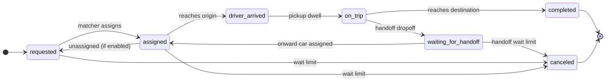

# ride-hailing-simulator: Specification

A deterministic discrete-event simulator that replays rider requests against a fleet, with pluggable matching, routing, readers and writers.

## Contents

- [Goal and scope](#goal-and-scope)
- [Conventions](#conventions)
- [Inputs and settings](#inputs-and-settings)
- [File formats and I/O plugins](#file-formats-and-io-plugins)
- [Lifecycles](#lifecycles)
- [Routing hook](#routing-hook)
- [Matching hook](#matching-hook)
- [Driver behavior](#driver-behavior)
- [Simulation loop](#simulation-loop)
- [Outputs](#outputs)
- [Worked example](#worked-example)
- [Testing](#testing)
- [Decisions](#decisions)

## Goal and scope

Replay a time-ordered sequence of rideshare requests against a fleet of supply (cars). Use the result to evaluate matching strategies on rider wait, trip efficiency and fleet utilization. Matching and routing are plug-ins; the simulator owns time, state, location interpolation and logging.

- In scope: the event clock, request and supply lifecycles, rider cancellations, plan execution, interpolating positions, output logs and summary metrics.
- Out of scope (v1): pricing, traffic that changes during a route, and rider walking. Idle repositioning comes from plans the matcher sends or from the [driver behavior](#driver-behavior) plugin. No built-in plugin declines offers yet.

## Conventions

| Item | Convention |
|---|---|
| Timestamps | Unix epoch integers in seconds, such as `1793721600`, in inputs and outputs alike. Field names end in `_at` |
| Location | `{lat, lng}` as signed decimal degrees (WGS84), such as `{"lat": 37.802851, "lng": -122.405822}`. South and west are negative, with no N, S, E or W letters |
| Distance | Integer meters, with field names ending in `_meters` |
| Duration | Integer seconds, with field names ending in `_seconds` |
| Naming | Explicit names only, with no abbreviations such as `_s`, `_m` or `avg` |
| Polyline | Encoded polyline or a list of `{lat, lng}` points, chosen once per run |
| IDs | Strings: `request_id`, `supply_id`, `plan_id` |
| Tie-break | Same-timestamp events run in the order offline, dropoff, pickup, cancellation, supply online, request, batch tick, then by ID |
| Determinism | No random numbers anywhere in the simulator. Iteration order is always sorted by ID. |

## Inputs and settings

### Settings file

| Setting | Type | Default | Meaning |
|---|---|---|---|
| `max_request_to_assignment_seconds` | seconds | none (off) | The rider cancels if still not assigned this long after requesting |
| `max_request_to_pickup_seconds` | seconds | none (off) | The rider cancels if not picked up this long after requesting, whether assigned or not |
| `pooling_enabled` | bool | false | Allows more than one request on a car at once, within seats |
| `reassignment_enabled` | bool | true | Allows moving an assigned request to another car before pickup |
| `batch_matching_interval_seconds` | seconds | none (off) | Also calls the matcher on this fixed interval from the start |
| `pickup_dwell_seconds` | seconds | 0 | Time stopped at a pickup |
| `dropoff_dwell_seconds` | seconds | 0 | Time stopped at a dropoff |
| `default_num_requested_seats` | int | 4 | Used when a request leaves it out |
| `default_num_available_seats` | int | 4 | Used when a supply leaves it out |
| `average_speed_meters_per_second` | float | router-specific | Used only by the built-in straight-line router |
| `timezone` | IANA zone name | none | Display only: the zone where the scenario takes place, such as `America/Chicago`. Never changes the simulation. Recorded in run metadata so tools can show local wall-clock times. An unknown name (or `Local`) is an error |
| `handoffs_enabled` | bool | false | Turns on generic mid-trip handoff primitives (optional stop locations, `waiting_for_handoff`, linked-batch validation, `trip_legs.csv`). Left out of the settings JSON when false so existing hashes stay the same |
| `max_handoff_wait_seconds` | seconds | none (off) | Deadline from each handoff dropoff until the next actual pickup, covering `waiting_for_handoff` and the assigned / `driver_arrived` onward states. Does not reuse `max_request_to_pickup_seconds` |
| `stop_when_requests_resolved` | bool | true | Ends the run as soon as every request has arrived and is `completed` or `canceled` (none `requested`, `assigned`, `driver_arrived`, `on_trip` or `waiting_for_handoff`, and no request still to come). Every car still online then goes `offline` at that time, so `offline_at`, idle time and distance, utilization and `simulation_end_at` stop there. False runs until the event queue is empty (cars stay online until their own `offline_at`), exactly as before the setting existed. Always recorded in the settings JSON |

The settings file is TOML. It also names the matching hook, the driver behavior plugin (`[hooks] driver_behavior`, default `simple`), the routing hook, and the reader and writer plugins along with their options, such as file paths or a database connection.

The built-in `greedy_nearest_eta` matcher reads one option from a `[matching]` section:

| Setting | Default | Meaning |
|---|---|---|
| `max_candidate_cars` | 0 (no limit) | Before asking the router for pickup times, keep only the N cars closest to the request's pickup by haversine distance from each car's current, interpolated position, ties to the lowest `supply_id`. The limit applies separately to open cars (empty plan: idle or repositioning) and to busy cars (a non-empty plan: forward dispatch or pooling), so up to 2N cars are priced per request. It applies on every trigger, including batch ticks and reassignment checks; the request's current car is always priced. Router prefetches cover only the kept cars. 0 prices every car and is left out of the `settings` JSON, so existing runs keep their bytes and `settings_sha256` |
| `max_rider_path_ratio` | none | Optional. Recorded in run metadata when set. Used by `experiments/transfermatcher` as the transfer path-ratio cap (Comparison B uses 1.25). Left out of the settings JSON when unset |
| `max_insertion_evaluations` | none | Optional. Recorded in run metadata when set. Per-Match insertion-evaluation budget for `experiments/transfermatcher` **transfer / provisional / onward scoring only** (Comparison B uses 5000; one evaluation includes path-distance measurement). Does not cap built-in greedy. Left out when unset |
| `transfers_enabled` | none | Optional experiment-only switch for `transfermatcher`. Recorded when set. Default true when unset. False keeps greedy ordinary assignments with handoffs on, while still rematching `waiting_for_handoff` |

`[hooks] routing = "osrm"` selects the OSRM router; its options live in their own `[osrm]` section:

| Setting | Default | Meaning |
|---|---|---|
| `url` | `http://127.0.0.1:5000` | OSRM server |
| `profile` | `car` | OSRM profile name in the request URL |
| `cache_path` | none | Optional JSON-lines leg cache, read at start and appended to |
| `dataset_metadata_path` | none | The `metadata.json` written by `scripts/osrm_setup.sh` |
| `dataset_name`, `dataset_date`, `dataset_sha256` | from the metadata file | Override or replace the metadata file |

### Demand (ride requests)

| Field | Type | Notes |
|---|---|---|
| `request_id` | string | Unique |
| `requested_at` | time | When the rider requests |
| `origin_lat` | decimal | Pickup latitude |
| `origin_lng` | decimal | Pickup longitude |
| `destination_lat` | decimal | Dropoff latitude |
| `destination_lng` | decimal | Dropoff longitude |
| `num_requested_seats` | int | Optional; defaults to the setting |
| `max_request_to_assignment_seconds` | seconds | Optional override of the setting |
| `max_request_to_pickup_seconds` | seconds | Optional override of the setting |

### Supply (cars)

| Field | Type | Notes |
|---|---|---|
| `supply_id` | string | Unique |
| `online_at` | time | May be before the first request |
| `online_lat` | decimal | Latitude where it comes online |
| `online_lng` | decimal | Longitude where it comes online |
| `offline_at` | time | Optional; goes offline once its plan is finished |
| `num_available_seats` | int | Optional; defaults to the setting |

## File formats and I/O plugins

| Data | Default format |
|---|---|
| Settings | TOML file |
| Ride requests, supply | CSV with a header row |
| Trips, supply event log, supply summary, run summary, run metadata | CSV with a header row |

### CSV conventions

- Timestamps, distances and durations are integers; an empty cell means null or unset.
- Polylines are a single encoded-polyline string per cell.
- A list such as `plan` is a JSON string in one cell.
- Optional input columns can be left out entirely; settings defaults apply.

### Reader and writer plugins

The simulator core never touches files directly. It talks to small interfaces, and CSV is just the default implementation, so a database, Parquet or an in-memory source can be swapped in through settings without changing the core.

| Interface | Contract |
|---|---|
| `SettingsReader` | Returns the validated settings object. The default reads TOML |
| `RequestReader` | Yields ride requests in `requested_at` order (or the simulator sorts them) |
| `SupplyReader` | Yields supply records |
| `OutputWriter` | One per output stream: `open()`, `write(record)` (or a batch), `close()`. The simulator can stream rows as they happen |

Each plugin works with typed records whose field names match this spec, so every reader and writer shares one schema. Validation (required fields, ranges, unique IDs) runs in the core after reading, so it's the same for every source.

## Lifecycles

Request lifecycle (the dashed edge applies only when reassignment is enabled):



A cancellation records which limit fired in `cancel_reason` (`max_request_to_assignment`, `max_request_to_pickup`, or `max_handoff_wait`). The assignment limit is checked against `requested_at` plus `max_request_to_assignment_seconds`: at any time from that deadline on, if the request is waiting with no car assigned (never assigned, or unassigned again), the rider cancels. `max_request_to_pickup_seconds` applies only to not-yet-boarded current-leg states (`requested`, `assigned`, `driver_arrived`), never to later legs. `max_handoff_wait_seconds` is measured from each actual handoff dropoff until the next pickup. An `on_trip` rider is never canceled by wait limits. If a request is canceled, the simulator removes its stops from the car's plan and reroutes the car.

### Handoffs (optional)

When `handoffs_enabled` is true, a matcher stop may include an optional `location`. Unset means today's behavior: pickup at origin, dropoff at destination. A dropoff at the destination (location absent or equal) is always **final**. A **handoff dropoff** uses an explicit location that differs from the destination; the rider leaves the car as `waiting_for_handoff` and seats free. An **onward pickup** of a waiting rider must use exactly that handoff location. Core allows at most one outstanding onward pickup per rider.

The simulator validates the **complete matcher batch** against the proposed post-batch state. A handoff dropoff may have zero or one onward pickup in that batch (v1 installs onward only after the dropoff); more than one onward pickup, duplicate final dropoffs, or wrong onward locations reject the batch. At most one pickup is allowed globally per request, except the first-leg origin pickup paired with a single onward pickup at the handoff location. Linked handoff batches are **all-or-nothing**: any invalid plan, router failure, or `plan_declined` rejects every proposed change (`plan_rejected` per supply, prior plans kept).

After a handoff dropoff the rider becomes `waiting_for_handoff` and the matcher is called once so an onward car can be assigned immediately. There are no deferred/opaque pending plans. If an onward car goes offline before pickup, or a matcher drops that onward pickup, the core removes only the pending onward pickup (never an aboard rider's dropoff), clears `assigned_at` / ETA, leaves the rider `waiting_for_handoff` unassigned, logs `stop_removed`, and lets later matcher calls rematch. The handoff timeout guarantees eventual resolution.

Supply states are `offline`, `idle` (online with no plan, standing still), `repositioning` (online with no plan, driving to a target its [driver behavior](#driver-behavior) chose), `en_route` (next stop is a pickup and no rider is aboard), `on_trip` (at least one rider aboard), and `going_offline` (past offline_at but still finishing its plan).

## Routing hook

The simulator calls this whenever a supply's plan changes. The matcher can also call it to estimate candidate plans.

| | Shape |
|---|---|
| Input | `route(start: location, waypoints: location[], depart_at: time)` |
| Output | `legs[]`, one per consecutive pair of stops. Each leg is `{segments[], distance_meters, duration_seconds}` |
| Segment | `{polyline, distance_meters, duration_seconds}`; the vehicle moves at constant speed within a segment |
| Units | `distance_meters` and `duration_seconds` are integers, so every event in the simulation falls on a whole second |
| Errors | Unroutable returns an error. The simulator rejects that plan change and logs it |
| Determinism | Must return the same output for the same input for runs to be reproducible |

Reference implementation: literal straight lines. Distance is the great-circle (haversine) distance between points, rounded to whole meters. Duration is computed from that rounded distance: `duration_seconds = round(distance_meters / average_speed_meters_per_second)`. Each leg is one straight segment.

Optional extensions a router may implement; callers use them when present and fall back to `route` otherwise, so routers that skip them are unaffected:

| Extension | Shape | Use |
|---|---|---|
| Estimate | `estimate(start, waypoints, depart_at)` | Same legs, durations and distances as `route`, possibly without polylines. The built-in matcher prices candidate plans with it |
| Prefetch | `prefetch(sources[], destinations[], depart_at)` | Hint that legs from every source to every destination are about to be asked for. Must not change any result. The built-in matcher sends, once per call, every eligible car and planned stop to every open pickup and dropoff. With `max_candidate_cars` set it instead sends, once per call, each open request's kept cars, their planned stops and the open pickups and dropoffs to the open pickups, dropoffs and those planned stops, so pooling insertions are covered too. Candidates are ranked against the plans at the start of the call; legs for a candidate that only appears after an earlier assignment in the same call are fetched on demand |
| Metadata | `router_metadata()` | Router name, engine version and road dataset, recorded in `run_metadata` |

### OSRM router

`[hooks] routing = "osrm"` routes on real roads with an [OSRM](https://project-osrm.org/) server, typically one started by `scripts/osrm_setup.sh` (see the README). Austin is the benchmark region.

- **Points.** Every point is rounded to 1e-5 degrees (about 1 m) before it is sent or used as a cache key, so equal inputs make equal requests.
- **Duration and distance** of a leg always come from `/table` with `annotations=duration,distance`, whether the pair was prefetched in a many-to-many request or fetched alone, so results don't depend on call order. They are rounded to whole seconds and meters, halves away from zero. A leg between equal rounded points is zero.
- **Polyline** comes from `/route` with `overview=full&geometries=polyline`, which is Google's encoded polyline at precision 5, the same format as our outputs. It is fetched only by `route`, never by `estimate`, and is drawn from the exact stop, along OSRM's road shape, to the exact next stop. Each leg is one segment, so a car moves at the leg's average speed.
- **Speeds** are the car profile's free-flow speeds. `depart_at` is ignored. Time-of-day speed profiles are future work: the setup script builds with MLD, which takes traffic updates (`osrm-customize --segment-speed-file`) without a full rebuild.
- **Cache.** An in-memory cache always holds every leg. With `cache_path`, every leg a run actually uses (not every prefetched pair) is also appended to a JSON-lines file whose header names the profile and dataset SHA-256; a file for another dataset is rejected. A rerun with the same inputs then needs no server.
- **Startup.** The router probes `/nearest` and fails fast with a clear error when the server doesn't answer, unless the cache file has entries, in which case it routes from the cache alone and fails on any leg it doesn't hold.
- **Errors.** A `null` table entry or `NoRoute` is unroutable.
- **run_metadata.** `settings` gains a `router` object: `name`, `profile`, `engine_version` (from the setup metadata), `dataset_name`, `dataset_date` and `dataset_sha256` of the cropped `.osm.pbf`. The straight-line router leaves it out, so its settings hashes are unchanged.

## Matching hook

| | Shape |
|---|---|
| Input | `now`, `trigger` (`request`, `supply_online`, `supply_offline` or `batch_tick`), the settings, every online supply, every open request (requested or assigned, not yet picked up, not canceled), and the routing handle |
| Supply view | `{supply_id, location, state, num_available_seats, seats_in_use, plan}`. The plan lists each waypoint as `{request_id, type: pickup\|dropoff, location, eta_at}` for every remaining stop |
| Request view | `{request_id, requested_at, origin, destination, num_requested_seats, status, supply_id, assigned_at, cancel_at, handoff_location?, realized_aboard_distance_meters}`. `cancel_at` is the earliest time a wait limit will cancel it. `realized_aboard_distance_meters` is the sum of completed trip-leg distances (exact O→…→H after a handoff dropoff); read-only for matchers |
| Output | A list of plan changes: `{supply_id, plan}`, where `plan` is the ordered list of stops, each `{request_id, type, location?}` (`location` optional). An empty list means no supply state changes (a no-op) |
| Open requests | Also includes `waiting_for_handoff` riders. `handoff_location` is set on those views |

The matcher sends only the ordered stops. The simulator starts the plan from the car's current location and adds the route and the ETA of each stop; that full plan is what the matcher sees on its next call.

### Validation (simulator enforces)

- Each request's pickup comes before its dropoff, and both are in the same plan.
- Riders already aboard keep their dropoff and stay with their car.
- With pooling off, at most one rider is aboard at a time: each pickup must come after the previous request's dropoff. A plan can still hold several requests back to back (forward dispatch).
- With pooling on, seats in use never exceed `num_available_seats` at any point along the plan.
- With reassignment off, an assigned request can't be moved to another car or dropped from its plan.
- A request is in at most one plan.
- An invalid change is rejected as a whole and logged as `plan_rejected`; the supply keeps its previous plan.

## Driver behavior

A driver behavior plugin decides what drivers do on their own, outside the matcher's plans. It's chosen in settings and registered by name like the matcher, router, readers and writers:

```toml
[hooks]
driver_behavior = "return_to_origin"   # default "simple"
```

### Interface

Every hook gets a `DriverState`: `{now, supply_id, state, location, online_location, online_at, offline_at, num_available_seats, seats_in_use, plan}`, where `location` is the car's interpolated position now and `plan` is its current plan with ETAs, as in the matcher's supply view.

| Hook | Called | Returns |
|---|---|---|
| `on_assignment_offered(car, plan)` | Before a valid matcher plan change that adds at least one pickup the car doesn't already have is applied | `accept: bool`. Declining rejects the whole change: the car keeps its previous plan and logs `plan_declined`. Requests the change would have moved stay where they were, or become `requested` if their old car's plan dropped them |
| `on_idle(car)` | Whenever the car's plan becomes empty while it's online and not `going_offline`: after a dropoff, after a cancellation or unassignment empties it, and on `reposition_arrived` | An optional reposition target. Nothing, or the car's current location, means stand still |

Plugins must be deterministic: the same inputs give the same answers, with no wall clock and no unseeded randomness. Future behaviors (declining offers, choosing when to go online or offline, choosing reposition targets from demand) extend this interface with new hooks that default to today's behavior.

### Built-in plugins

| Name | Behavior |
|---|---|
| `simple` (default) | Accepts every assignment, goes online and offline once as its supply row says, and stands still when it has no plan. This is the simulator's behavior before plugins existed, and its outputs are byte-identical |
| `return_to_origin` | Like `simple`, but whenever `on_idle` is called away from its supply `online_lat`/`online_lng`, it drives back there |

### Repositioning

- **Start.** When `on_idle` returns a target different from the car's location, the simulator routes there from the current location and logs `reposition_started` (`state_after = repositioning`, `planned_polyline` set, `plan` empty). It comes right after the `idle` row at the same second.
- **Movement.** The car moves along the route and is interpolated like any driving car.
- **Arrival.** At the end of the route it logs `reposition_arrived` (`state_after = idle`) and `on_idle` is called again. A reposition arrival sorts with dropoffs in the tie-break.
- **Assignable.** A repositioning car is open to the matcher on every call, including batch ticks. The matcher sees `state = repositioning`, its interpolated location and an empty plan, so its ETAs are measured from where the car is now. Any accepted plan change ends the reposition at that point and routes from there. The `plan_updated` row's `driven_polyline` shows how far it got. Pooling, reassignment and batching rules don't change, because a repositioning car never has stops.
- **Going offline.** If `offline_at` arrives while the car is repositioning, its plan is empty, so it goes `offline` immediately at its interpolated position, as an idle car would. A `going_offline` car never repositions.
- **Accounting.** Repositioning time and distance count as idle (`idle_seconds`, `idle_meters`) and as deadhead. Reposition arrivals are internal events, so they never call the matcher, and they keep the run going. With `stop_when_requests_resolved = false`, `simulation_end_at` includes a final return trip; with the default early stop the run ends at the last dropoff or cancellation and a repositioning car goes offline wherever it is then.
- **Router errors.** If the router can't route the reposition, the car logs `reposition_rejected` and stays idle.

### Registering external hooks

Hooks are chosen by name from a registry in `runner`. An external package can call `runner.RegisterMatcher`, `runner.RegisterRouter` or `runner.RegisterDriverBehavior` with a name and a constructor (usually in `init`), and then select it by that name in `[hooks]`, so it doesn't need to fork the core. The built-in hooks register themselves the same way. Registering a name that is already taken returns `<kind> "<name>" is already registered`. A name that isn't registered fails the run with `unknown <kind> "<name>"`.

## Simulation loop

1. **Initialize.** Load the settings and inputs, filling in defaults. The clock starts at the first `requested_at`. Supply with `online_at` before that is online and idle at (`online_lat`, `online_lng`).
2. **Queue events.** A priority queue holds external events (request, supply online, supply offline), internal ones (arrive at stop, dwell done, cancellation deadline) and batch ticks every `batch_matching_interval_seconds`. Order is by time, then the tie-break rule.
3. **Advance.** Pop the next event, set the clock to it, and interpolate every moving supply's position along its current route.
4. **Apply the event.** Update request and supply state, including cancellations and removing canceled stops, and write to the event log.
5. **Match.** Call the matcher only on external events (request, supply online, supply offline) and batch ticks. Internal events (arrivals, dwells done, pickups, dropoffs, cancellations) update state and logs but never call the matcher. Validate and apply its plan changes.
6. **Route.** For each changed plan, call the router from the current location, replace the route, recompute waypoint ETAs, and reschedule arrival events. Stale ones are cancelled.
7. **Terminate.** Stop once every supply plan is finished and no requests, arrivals or deadlines remain. Batch ticks alone don't keep the run going. Then write the outputs.

> **Interpolation:** A car drives each leg at constant speed: after t of the leg's duration it has driven the same fraction of the leg's `distance_meters` (rounded to whole meters, which is what the odometer and supply meters count). It is placed at that fraction of the length of the leg's geometry (the segments' polylines joined, measured point to point), interpolating linearly within the polyline piece it falls on. When the car is synced mid-leg (a reroute, a cancellation, any committed position), the rest of the leg continues from that point along the remaining geometry. The geometry only places the car; distances and durations always come from the router's legs. With a single straight segment (the straight-line router) this is plain linear interpolation between the stops. During a dwell, the car stays at the stop.

## Outputs

### 1. Trips (one row per request)

| Field | Meaning |
|---|---|
| `request_id` | The request |
| `status` | Final status: `completed` or `canceled` |
| `requested_at` | When the rider requested |
| `num_requested_seats` | Seats used |
| `first_assigned_at` | First assignment time |
| `assigned_at` | Final assignment time |
| `supply_id` | Final car |
| `reassign_count` | How many times the request was reassigned |
| `ridepool_type` | The pickups (`p`) and dropoffs (`d`) the car made between this trip's final `assigned_at` and its dropoff, in order. `0` is this trip; other requests are numbered `1` to `n` in the order they first appear. A normal trip is `p0d0`, a forward dispatch is `d1p0d0`, and a pooled trip might be `p0p1d0`. Empty for a canceled trip |
| `eta_at_assignment_seconds` | Pickup ETA quoted at the final assignment |
| `driver_arrived_at` | Car reaches the origin |
| `pickup_at` | Rider boards, after the dwell |
| `dropoff_at` | Rider gets out, at the end of the dropoff dwell |
| `wait_seconds` | `pickup_at` minus `requested_at` |
| `trip_distance_meters` | Distance from pickup to dropoff as driven, including pooling detours |
| `trip_duration_seconds` | `dropoff_at` minus `pickup_at`, including pooling detours and the dropoff dwell |
| `direct_distance_meters` | Distance of the direct route from origin to destination |
| `direct_duration_seconds` | Router duration of the direct route from origin to destination, with no dwells |
| `detour_ratio` | `trip_distance_meters` divided by `direct_distance_meters` |
| `pickup_distance_meters` | Distance the car drove to the pickup after the final assignment |
| `max_co_riders` | Most other riders aboard at once while this rider was aboard; `0` means never shared. Empty if never picked up |
| `canceled_at` | When the rider canceled, if they did |
| `cancel_reason` | Which limit fired: `max_request_to_assignment`, `max_request_to_pickup`, or `max_handoff_wait` |
| `handoff_count` | Only when `handoffs_enabled`: number of handoff dropoffs on this trip |
| `total_handoff_wait_seconds` | Only when `handoffs_enabled`: sum of waits from each handoff dropoff to the next pickup |

### 1b. Trip legs (only when `handoffs_enabled`)

One row per vehicle leg, deterministic order by `request_id` then `leg_index`:

| Field | Meaning |
|---|---|
| `request_id` | The request |
| `leg_index` | 0-based index along the trip |
| `supply_id` | Car that drove this leg |
| `start_lat`, `start_lng` | Pickup / handoff start |
| `end_lat`, `end_lng` | Dropoff / handoff end |
| `pickup_at`, `dropoff_at` | Board and alight times |
| `distance_meters`, `duration_seconds` | Driven on this leg |

Non-handoff-configured runs omit these columns and `trip_legs.csv`, so existing goldens stay byte-identical.

### 2. Supply event log (one row per action)

| Field | Meaning |
|---|---|
| `supply_id` | The car |
| `at` | When the action happened |
| `action` | One of `online`, `plan_updated`, `plan_rejected`, `plan_declined` (the driver behavior declined it), `arrived_pickup`, `pickup`, `arrived_dropoff`, `dropoff`, `stop_removed` (the rider canceled), `idle`, `reposition_started`, `reposition_arrived`, `reposition_rejected`, `offline` |
| `lat` | Car latitude at the action |
| `lng` | Car longitude at the action |
| `state_after` | Car state after the action |
| `request_id` | Related request, if any |
| `plan_id` | Current plan |
| `seats_in_use` | Seats in use after the action |
| `odometer_meters` | Total distance driven so far |
| `driven_polyline` | The path actually driven since this car's previous row: the previous row's location, every route-geometry point passed (and the point where it was rerouted, if any), then this row's location. Empty if the car didn't move |
| `planned_polyline` | On `plan_updated` and `reposition_started` rows: the full new route from the router, every leg's geometry joined, starting at the car's current location (or the stop it is dwelling at) |
| `plan` | On `plan_updated` rows: the new plan's stops with their ETAs |

### 3. Supply summary (one row per supply)

| Field | Meaning |
|---|---|
| `supply_id` | The car |
| `online_at` | When it came online |
| `offline_at` | When it went offline, or empty if it never did |
| `idle_seconds` | Time spent idle, including repositioning |
| `en_route_seconds` | Time spent driving to pickups with no rider aboard |
| `on_trip_seconds` | Time with at least one rider aboard |
| `idle_meters` | Distance driven while idle (repositioning, whether from the driver behavior or a matcher plan) |
| `en_route_meters` | Distance driven to pickups with no rider aboard |
| `on_trip_meters` | Distance driven with at least one rider aboard |
| `requests_served` | Requests completed |
| `utilization` | `on_trip_seconds` divided by time online |
| `deadhead_ratio` | Distance driven with no rider aboard divided by total distance |
| `full_polyline` | The car's whole driven path: its online location followed by every row's `driven_polyline` points, joints not repeated |

### 4. Run summary

Totals: requests completed and canceled (split by reason), median and p90 wait, mean detour ratio, fleet utilization, matcher calls by trigger, and time spent in the matcher and router.

### 5. Run metadata (one row)

Identifies the run so two runs can be compared as a pair.

| Field | Meaning |
|---|---|
| `simulator_version` | Version of the simulator that produced the outputs |
| `requests_sha256` | SHA-256 of the parsed ride requests: records sorted by `request_id` with defaults filled in, as canonical JSON. Reformatting the CSV doesn't change it |
| `supply_sha256` | SHA-256 of the parsed supply, built the same way and sorted by `supply_id` |
| `settings_sha256` | SHA-256 of `settings` |
| `settings` | The settings the run actually used, defaults filled in, as JSON. Reader and writer paths are left out so moving files doesn't change the hash. `driver_behavior_hook` is included only when it isn't the default `simple`, and `timezone` only when set |
| `simulation_start_at` | Simulated clock start: the first `requested_at` |
| `simulation_end_at` | Simulated time of the last processed event (batch ticks excluded). With `stop_when_requests_resolved` (default) this is when the last request was resolved |
| `timezone` | Optional, last column: the `[simulation] timezone` setting. The column is written only when the setting is set, so runs without it keep the same columns and bytes |

Two runs are **paired** when `requests_sha256` and `supply_sha256` match. A different `settings_sha256` is expected when comparing strategies.

## Command line

```sh
rhs run -settings settings.toml -supply supply.csv -requests requests.csv -output out/ [-progress=false]
```

Flags override the paths in the settings file's `[io]` section. Calling `rhs` with flags and no subcommand still means `run`. The output viewer (`rhs view`) is specified in [tooling_spec.md](tooling_spec.md).

### Live progress

While a run is in progress, `rhs run` prints a status line on stderr:

- A percent bar from simulated time versus the scenario horizon (the latest `requested_at`, `online_at` or `offline_at` in the inputs). After the horizon the bar stays at 100% while remaining trips finish, and the final line always reads 100%, including when the run stops early because every request is resolved.
- Elapsed wall time and an estimate of time remaining.
- The simulated clock as `T+N` plus local wall-clock time when `[simulation] timezone` is set, matching the viewer. Before the first request (supply coming online early) it reads `before first request` instead of a negative offset.
- Drivers online, split into idle, en route, on trip and repositioning.
- Requests waiting, assigned (including driver arrived and on trip), completed and canceled.
- When the OSRM router is in use: `/table` requests, `/route` requests and cache hits (pairs served without a new HTTP request).

After the outputs are written, one summary line follows: `done: N completed, N canceled / N requests | wait median Ns, p90 Ns | fleet utilization N% | outputs in DIR`, taken from `run_summary.csv`.

On a terminal the line redraws in place about four times a second. When stderr is not a terminal, a plain line is printed every few seconds instead. `-progress=false` turns the status line off. Progress is display only: it does not change outputs, hashes or determinism.

## Worked example

_Pooling on_

| Time | Event | Result |
|---|---|---|
| T0 | S1 online at L1 | S1 idle; the clock hasn't started yet |
| T1 | R1 requested, O1 to D1 | The clock starts. The matcher returns S1 with plan [pickup R1, dropoff R1]. The router returns legs L1 to O1 and O1 to D1, and ETAs are set for both stops |
| T2 | R2 requested, O2 to D2 | S1 is interpolated to L2. The matcher sees S1's plan with ETAs and returns [pickup R1, dropoff R1, pickup R2, dropoff R2]. The router is called again from L2 |
| Every interval | Batch tick | The matcher is called; an empty result changes nothing |
| T3 to T6 | Arrivals and dwells | Arrival, pickup and dropoff are logged for R1, then for R2, each row with its driven polyline |
| End | R1 and R2 are both completed and no request is still to come | S1 goes offline at T6 and the outputs are written (with `stop_when_requests_resolved = false`: once the queue is empty) |

## Testing

- **Component tests only.** Every test is a [component test](https://martinfowler.com/articles/microservice-testing/#testing-component) (integration or end-to-end): it runs a full simulation from fixture files and makes assertions on the outputs (trips, supply event log, supply summary and run summary). There is no unit-test requirement.
- **Fixtures.** Each test is a combination of one settings TOML file, one supply CSV and one demand CSV. Fixtures are shared and reused across tests rather than copied per test.
- **Minimal assertions.** One or two tests assert every field of every output exhaustively to verify correctness. Behavior tests, such as a simple pool, assert only the few things that behavior is about. Less is more.
- **Hooks.** Tests use the built-in straight-line router and a deterministic reference matcher defined for tests. The OSRM router is tested against a fake OSRM server (`httptest`); a test against a real server runs only when `OSRM_URL` is set.
- **Benchmarks.** Benchmark scenarios built from public data are specified in [benchmark_spec.md](benchmark_spec.md).
- **Naming and cases.** Fixture layout, naming conventions, landmark coordinates, the reference matcher and the test cases are in [test_specs.md](test_specs.md).

## Decisions

1. **Driver behavior is a plugin.** It's chosen by name in `[hooks] driver_behavior`, alongside `matching` and `routing`, and registered like the matcher and router. `simple` is the default and reproduces the earlier behavior byte for byte.
2. **Default settings hash.** `driver_behavior_hook` is left out of the `settings` JSON when it's `simple`, so runs from before the plugin existed keep their `settings_sha256` and stay comparable. Naming `simple` explicitly gives the same hash.
3. **Repositioning state.** Repositioning is a separate supply state, `repositioning`, so logs and the viewer can tell it from standing still. For time and distance accounting it counts as idle, so the supply summary columns and utilization formulas don't change.
4. **Assignable while repositioning.** A repositioning car can be matched from its interpolated position. An assignment ends the reposition where the car is, with no extra log row; the `plan_updated` row marks it.
5. **Offline wins.** `offline_at` during a reposition takes the car offline right where it is. Cars never reposition while `going_offline`.
6. **Minimal hooks.** The interface has two hooks, `on_assignment_offered` and `on_idle`. Declining is supported by the interface but not by any built-in plugin yet. Online and offline decisions are future hooks.
7. **Timezone is display only.** `[simulation] timezone` never affects results. It is left out of the `settings` JSON and the `run_metadata` columns when unset, so earlier runs keep their bytes and `settings_sha256`. Setting it changes `settings_sha256`, like any other setting.
8. **Real roads through OSRM.** We call an OSRM server rather than write a Go router: OSRM is fast at many-to-many tables, free, runs offline in Docker and is deterministic for a fixed map and version. The Google Routes API was rejected for cost, latency and live-traffic results that break reproducibility.
9. **One source for leg costs.** OSRM's `/table` and `/route` can disagree slightly on the same pair, so a leg's duration and distance always come from `/table` and `/route` supplies only the shape. Matcher ETAs and driven times then agree.
10. **Reproducibility.** Coordinates are rounded to 1e-5 degrees, the map's SHA-256 and OSRM version go into `run_metadata`, and an optional cache file replays a run without a server.
11. **Austin first.** The road extract is the Geofabrik Texas file cropped to the Austin metro box `-98.20,29.90,-97.33,30.82` (every point in the Austin weekday benchmark plus about 10 km of margin).
12. **Candidate pruning by straight-line distance.** With OSRM, every matching decision priced every online car, so a full Austin run took over 26 minutes against 75 s on straight lines. `[matching] max_candidate_cars` keeps the N nearest cars by haversine distance before any router call. Haversine is free and ranks cars close to road time in a city, though a car across a river can be pruned even when its road time ties or beats a kept car's. Open and busy cars get separate limits of N each, so a nearby busy car never crowds out every idle car or the other way round. One setting serves both sets because a second knob had no observed use. The default stays 0 (no pruning) so every existing output is byte-identical.
13. **Live progress on stderr.** Status is a display concern, so it writes only to stderr and is on by default. The horizon for the percent bar is the latest input timestamp, which is known up front and stays fixed for the run; finishing work after that shows 100%. A terminal gets an in-place redraw so logs stay readable; pipes and files get plain lines. `-progress=false` keeps batch jobs and tests quiet.
